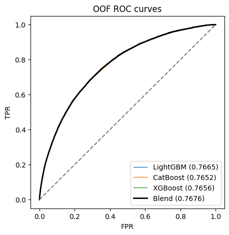
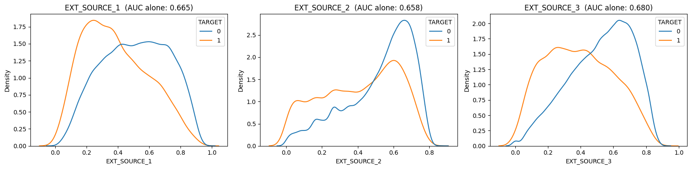
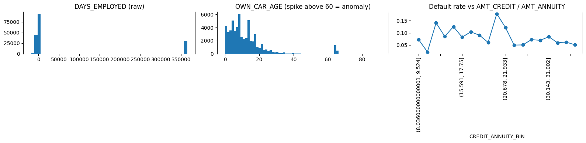
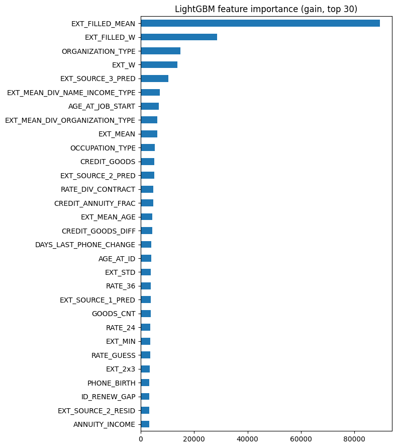

# Home Credit Default Risk — GCI World 2026 ML Competition

Predicting the probability that a loan applicant will default, using gradient-boosted tree ensembles and domain-driven feature engineering.

**Competition:** in-class competition of the *GCI World 2026 September* program (Global Consumer Intelligence course, University of Tokyo Matsuo Lab / Omnicampus), based on the Kaggle *Home Credit Default Risk* dataset (2018).
**Task:** binary classification: does the applicant have payment difficulties (`TARGET = 1`)?
**Metric:** ROC-AUC.

| | |
|---|---|
| **Final model** | Rank-weighted blend of LightGBM, CatBoost, and XGBoost |
| **Cross-validation AUC (5-fold)** | **0.7653** |
| **Public leaderboard AUC** | **0.76891** (first version without rate features: 0.76479) |
| **Public leaderboard rank** | **#520**, up from #1739 with the first version |
| **Tutorial baseline** | ~0.70 |
| **Features** | 32 raw → 114 after engineering |
| **Code submission grade** | 100 / 100 |

---

## Highlights

- **Implied interest rate feature.** The data gives the loan amount and the monthly payment but not the interest rate or the loan term. I recovered both by inverting the annuity formula. This lifted LightGBM CV AUC from **0.7601 to 0.7636**, the largest single gain in the project, and the derived features rank among the model's top-8 most important.
- **Robust validation.** I used 5-fold stratified cross-validation instead of a single hold-out. Every modelling decision was made on out-of-fold (OOF) AUC, never on the public leaderboard, to avoid overfitting a test subset.
- **Diverse ensemble.** Three boosting libraries with different handling of categorical features. They are blended by rank averaging (AUC only depends on ordering), with weights chosen on OOF predictions.
- **Fully reproducible and rule-compliant.** Fixed seeds throughout, no external data, no hand-labeling. One notebook regenerates the submitted CSV end to end.

---

## Results

| Model | 5-fold OOF AUC |
|---|---|
| LightGBM | 0.76376 |
| CatBoost | 0.76253 |
| XGBoost | 0.76275 |
| Equal-weight rank blend | 0.76517 |
| **Weighted rank blend** (0.45 / 0.40 / 0.15) | **0.76526** |

Fold scores range from 0.758 to 0.770, so the estimate is stable. The blend beats every single model even though the models' test predictions are highly correlated (ρ = 0.977–0.996): CatBoost's ordered target statistics give the most complementary errors.

<p align="center"></p>

### Experiment log

Every change was kept only if it improved OOF AUC. That includes ideas that did not work.

| # | Experiment (LightGBM, 5-fold CV) | AUC | Kept? |
|---|---|---|---|
| 0 | Tutorial: 5 features, Random Forest, hold-out | ~0.70 | — |
| 1 | All 32 features + anomaly cleaning + ~65 engineered features | 0.76011 | ✅ |
| 2 | + implied monthly interest rate for 8 loan terms | 0.76302 | ✅ |
| 3 | + KNN target mean (500 nearest neighbours on EXT_SOURCE & credit/annuity, computed out-of-fold) | 0.75886 | ❌ hurt CV |
| 4 | Rates for 11 terms + estimated term, total interest, rate relative to similar contracts | **0.76356** | ✅ |
| 5 | Three-model rank blend on top of #4 | **0.76526** | ✅ final |

The cross-validation gains carried over to the public leaderboard. The blend without rate features scored 0.76479 on the public leaderboard, and the final blend with them scored **0.76891** (+0.0041), slightly more than CV predicted (+0.0035).

---

## Approach

### 1. Exploratory data analysis
- **Imbalanced target.** About 8% defaults, so I use stratified folds and a ranking metric rather than accuracy.
- **External credit scores** (`EXT_SOURCE_1/2/3`) are by far the strongest raw predictors, and lower scores mean higher risk.
- **Data anomalies:** `DAYS_EMPLOYED = 365243` (≈1,000 years) is a placeholder for pensioners and unemployed applicants, affecting 30,898 rows with a default rate of 5.4% vs 8.7% for everyone else. `OWN_CAR_AGE ≥ 60` is an unnatural spike, and `XNA` marks a missing category.
- **Loan structure matters.** The default rate is *non-monotonic* in `AMT_CREDIT / AMT_ANNUITY`.

<p align="center"></p>
<p align="center"></p>

### 2. Cleaning
- Anomalies are converted to `NaN`, and indicator flags keep the information they carried (e.g. `DAYS_EMPLOYED_ANOM`).
- There is no mean imputation. Missingness is informative, and gradient-boosted trees learn the best split direction for `NaN` values themselves.

### 3. Feature engineering (32 → 114 features)

| Group | Examples | Intuition |
|---|---|---|
| **Implied interest rate** | `RATE_{6..60}`, `TERM_GUESS`, `RATE_GUESS`, `TOTAL_INTEREST`, `RATE_DIV_CONTRACT` | The rate a lender charges encodes its own risk assessment |
| Affordability ratios | credit/annuity, annuity/income, credit/goods price, income per family member | Payment burden and loan structure |
| External-score aggregates | mean, weighted sum, product, min/max/std, pairwise products | Combine the strongest signals |
| Time ratios | employment/age, ID-change/age, phone-change/age, age at loan end | Stability of the applicant |
| Group-relative features | applicant's EXT score or income ÷ mean of their organisation, occupation, education | "Compared with similar people…" |
| Frequency encodings | category counts, frequency of exact credit/annuity amounts | Popular loan products vs unusual ones |

**The implied-rate feature in detail.** For a loan of amount $C$ repaid in $n$ monthly payments $A$:

$$A = C \cdot \frac{r}{1-(1+r)^{-n}}$$

For each common term $n \in \{6, 10, 12, 18, 24, 30, 36, 42, 48, 54, 60\}$ months, I solve for $r$ with a vectorised bisection. The shortest term that yields a plausible rate (≥ 0.5 %/month) becomes the estimated term. Rate-derived features are among the most important in the final model, and `RATE_DIV_CONTRACT` (the applicant's rate relative to similar contracts) ranks 6th:

<p align="center"></p>

Group statistics and count encodings use **feature columns only**. The target is only seen inside training folds, so there is no target leakage.

### 4. Models
| Model | Key settings | Categorical handling |
|---|---|---|
| LightGBM | lr 0.02, 32 leaves, feature fraction 0.5, L2 = 5, early stopping 200 | native categorical splits |
| CatBoost | lr 0.06, depth 6, L2 = 5, `max_ctr_complexity=1` (≈10× faster, similar AUC) | ordered target statistics |
| XGBoost | lr 0.02, depth 5, `hist`, early stopping 200 | native categorical (`enable_categorical`) |

Each model is trained on 5 stratified folds. Test predictions are averaged over the 5 fold models.

### 5. Ensembling
Predictions are converted to ranks before blending, because AUC depends only on order and the three models are calibrated differently. A grid search over blend weights on the **OOF** predictions picks 0.45 / 0.40 / 0.15.

---

## Repository structure

```
├── solution.ipynb                       # Full solution: EDA → features → CV models → blend → submission
├── solution.zip                         # Zipped notebook (code submission for Omnicampus)
├── output/submission.csv                # Final predictions (SK_ID_CURR, TARGET)
├── assets/                              # Figures used in this README
├── tutorial.ipynb                       # Organiser-provided baseline tutorial
├── README.ipynb                         # Organiser-provided competition description and rules
├── HomeCredit_columns_description.xlsx  # Data dictionary
└── input/                               # data goes here (not included, see below)
```

## Data
The data files are **not included** in this repository. They are a subset of the Kaggle [Home Credit Default Risk](https://www.kaggle.com/c/home-credit-default-risk/data) dataset, distributed to GCI World 2026 participants under the competition's terms. To run the notebook, place the course-provided `train.csv`, `test.csv` and `sample_submission.csv` in `input/`. The column definitions are in `HomeCredit_columns_description.xlsx`.

## Reproducing the results

```bash
pip install numpy pandas scikit-learn lightgbm catboost xgboost matplotlib seaborn scipy jupyter
python -m nbconvert --to notebook --execute --inplace solution.ipynb
```

- Writes `output/submission.csv` and `solution.zip`. Seeds are fixed (`SEED = 42`), and re-runs reproduce the CV scores exactly.
- **Runtime:** about 45 min on an 8-core CPU, or about 2–3 h on free Google Colab. In Colab, set the folder path in the setup cell and uncomment the `pip install` line.
- **Tested with:** Python 3.12, LightGBM 4.7, CatBoost 1.2, XGBoost 3.4, pandas 2.1.

## Competition rules followed
- **No external data.** Only `train.csv` and `test.csv` are used.
- **No hand-labeling.** Every prediction is produced by the model.
- **Reproducibility.** All random seeds are fixed.
- **Citations.** Feature ideas such as the credit/annuity ratio, EXT_SOURCE combinations and the `DAYS_EMPLOYED` anomaly are well-known findings from public discussions of the original Kaggle competition (e.g. Will Koehrsen, *"Start Here: A Gentle Introduction"*). The implementation in this repository is my own.

## Possible next steps
- Hyperparameter search (Optuna) and multi-seed averaging
- A neural network or linear model on rank-transformed features, for more ensemble diversity
- Out-of-fold target encoding of high-cardinality categories

## Author
**Abdou Salam Sisawo**: GCI World 2026 September participant.
